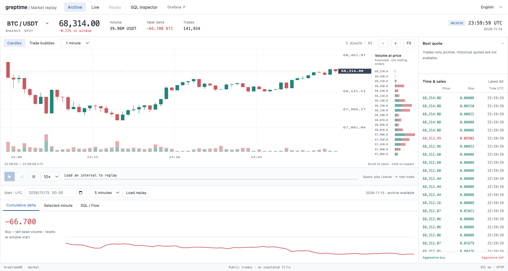
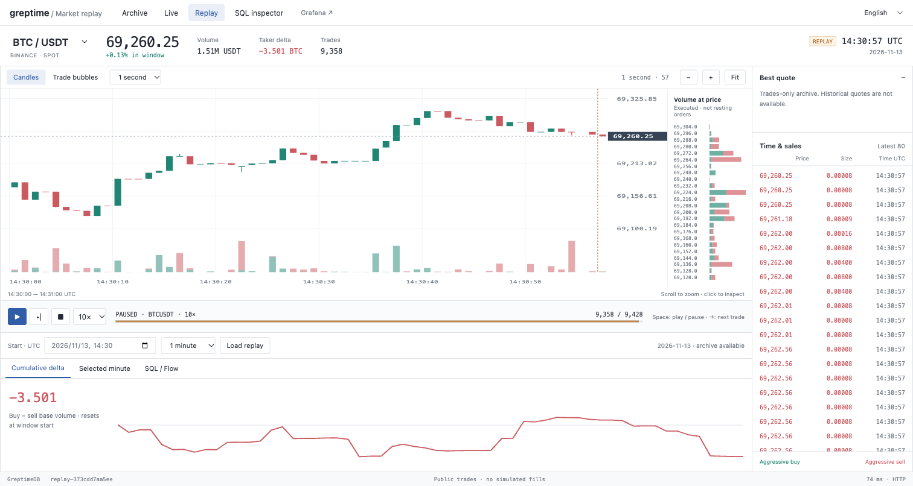
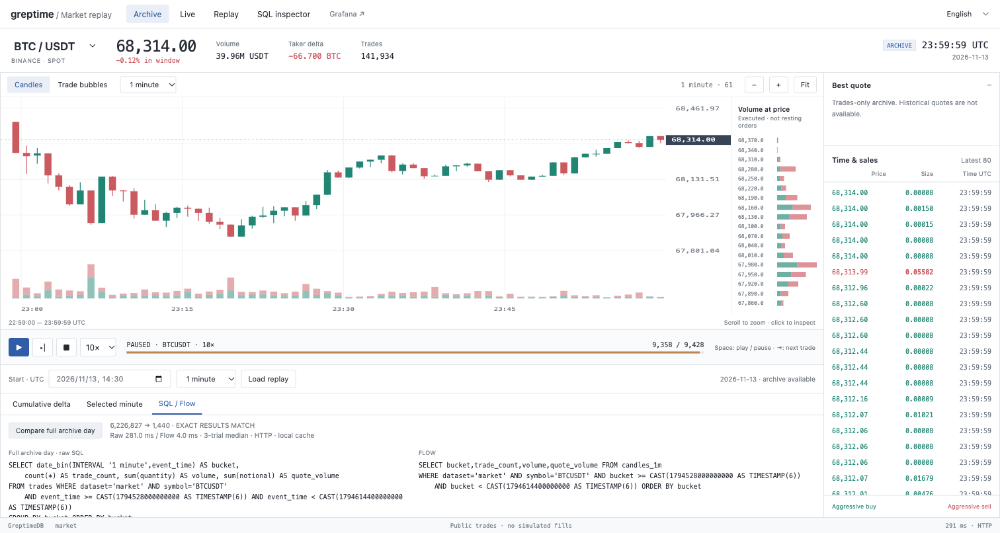

# Crypto Market Lab

A local market desk for Binance Spot BTC/USDT and ETH/USDT, backed by GreptimeDB. GreptimeDB stores public trades and sampled best quotes, and a Flow maintains minute OHLCV, quote volume, trade counts, and taker-buy volume. The desk replays archived trades and compares raw-event SQL with the Flow table.

## Screenshots

The final hour of an imported archive day, with minute candles, volume at price, time and sales, and cumulative delta.



A paused one-minute replay at 10× speed, drawn as one-second candles from raw trades.



The SQL inspector comparing a full archive day of raw-event aggregation with the Flow table.



## Run

Before you start, make sure Docker Compose can reach the Binance public market-data endpoints. The frontend regression test also requires Node.js. You don't need an exchange account or an API key.

```sh
cd crypto-market-lab
docker compose up -d --build
```

| Service | URL |
| --- | --- |
| Market desk | http://localhost:25200 |
| Market desk in Chinese | http://localhost:25200/?lang=zh-CN |
| Grafana diagnostics | http://localhost:25300 |
| GreptimeDB HTTP API | http://localhost:25400 |

To follow the collectors, run:

```sh
docker compose logs -f history live quotes
```

The `history` worker imports the most recent daily archive that is published for both symbols. It checks the previous three UTC days. The `live` and `quotes` collectors run independently of the import. Archives contain trades only, so historical quotes aren't available.

## Use the desk

The desk has three views:

- **Archive**: the final hour of the imported archive.
- **Live**: the most recent hour of live trades and the best quotes from the last 15 minutes.
- **Replay**: the active replay dataset. The view is available after you load a replay.

To inspect a minute, click the chart or a row in **Time & sales**. The **Selected minute** tab lists the 25 largest trades in that minute.

**SQL inspector** shows the query behind the chart and compares a complete archive day. To open this panel directly, go to `/#lab`.

The language selector switches between English and 简体中文. The `lang` URL parameter overrides the saved choice. Without the parameter, the desk uses the saved choice, then the browser language. Switching languages keeps the selected market and view. SQL text stays the same in both languages.

### Chart

- The mouse wheel zooms the chart, and a crosshair follows the pointer.
- **Trade bubbles** shows the 200 most recent trades. Bubble size represents base quantity, and color represents the aggressor side.
- **Time & sales** shows the 80 most recent trades.
- **Volume at price** groups executed base volume into price bands over the selected window. It doesn't represent resting orders or full market depth.
- **Cumulative delta** sums buy volume minus sell volume from the start of the window.

The desk doesn't place orders, simulate matching, or calculate P&L.

### Replay

To replay archived trades, select a UTC start minute and a 1- or 5-minute interval below the chart, and then click **Load replay**. The desk creates an isolated dataset and loads the interval paused. During playback, the desk writes trades into that dataset as the event clock advances.

| Control | Behavior |
| --- | --- |
| Play | Starts the event clock. |
| Pause | Stops after the last committed batch. |
| Step | Writes exactly one trade, including when several trades share a timestamp. |
| Speed | Switches between 1×, 10×, and 100× during playback or while paused. |
| Space | Toggles play and pause in the replay view when focus is outside form controls. |
| Right arrow | Advances one trade in the replay view when focus is outside form controls. |

Replay limits:

- One replay runs at a time, with a maximum of 100,000 trades.
- Each loaded interval creates a dataset. Stopped replays keep their partial results.
- Restarting the desk ends its in-memory replay session. Stored datasets remain queryable in Grafana.
- Replay never displays live quotes.

The replay chart, time and sales, volume at price, and selected-minute queries use the same committed event time and trade ID as their upper bound. One-second candles and replay candles are calculated from raw trades. Other minute candles come from the Flow table.

### SQL and Flow comparison

**Compare full archive day** runs the raw query and the Flow query three times each, alternating between them, and reports the median HTTP round-trip time, including serialization. It also checks that per-minute counts, volumes, and notionals match exactly. Timings depend on local hardware, concurrent ingestion, and cache state. The comparison isn't a controlled engine benchmark.

## Data and schema

| Table | Time index | Primary key | Contents |
| --- | --- | --- | --- |
| `trades` | `event_time`, microseconds | `dataset, symbol, trade_id` | Exact decimal price, quantity, notional, and taker side |
| `quotes` | `sampled_at`, microseconds | `dataset, symbol` | Latest changed best quote in each sampling interval of about one second |
| `candles_1m` | `bucket`, microseconds | `dataset, symbol` | Minute aggregates maintained by the Flow |
| `ingestion` | `ts`, microseconds | `dataset, symbol, worker` | Collector status and submitted batch statistics |
| `gaps` | `ts`, microseconds | `dataset, symbol` | Observed missing trade-ID ranges, without automatic backfill |

All data comes from Binance Spot, and symbol names refer to that venue. Historical imports and live capture write to the `market` dataset. Each replay writes to its own dataset.

### Row identity

A row's identity is its primary key plus its time index. Repeated writes deduplicate only when both match:

- Different trade IDs at the same microsecond remain separate rows.
- The same trade ID with a different timestamp is a different row.

### Precision

Price and quantity use `DECIMAL(24,8)`, and notional uses `DECIMAL(38,16)`. Parsing rejects price or quantity values with more precision than the column supports. The Flow orders open and close by event time, then by trade ID. Trade IDs identify events and don't appear in the keys of aggregate tables. The schema doesn't create inverted indexes on trade IDs.

### Timestamps and statistics

- `quotes.received_at` records when the collector received the message. Binance JSON `bookTicker` messages have no exchange event timestamp, so the quote age on the desk is the time since reception, not exchange latency.
- The `quotes` collector writes only changed observations. Quote update IDs are fields, not series dimensions. The snapshots don't contain full depth or order-level events.
- `trades.ingested_at` records when the batch was submitted, not when it was received from the network.
- Submitted-row statistics in `ingestion` count every submitted batch, including repeated imports. They aren't unique-trade counts.

No TTL is configured. Trades, quotes, and collector status accumulate until you remove them.

## Reproduce and verify

The `data/` directory, which Git ignores, caches downloaded ZIP files, checksums, and verification reports. Database files are stored in a Docker volume. Raw datasets aren't tracked in Git. `datasets.json` records the source URLs and SHA-256 values for the verified reference day. Before an import, the downloader validates each archive against the provider's `.CHECKSUM` file.

```sh
docker compose run --rm ingest history --date 2026-11-13
docker compose run --rm --entrypoint python ingest verify.py \
  --history-date 2026-11-13 --grafana http://grafana:3000
docker compose run --rm --entrypoint python ingest -m unittest test_quotes.py test_replay.py test_desk.py
node test_web.cjs en
node test_web.cjs zh-CN
```

The checks cover:

- Trade identity: same-microsecond trades, repeated writes, event ordering, and late arrivals.
- Aggregates: Flow totals, the official daily candles, and Grafana queries.
- Replay: completion, cancellation, pause boundaries, single-trade steps, and exclusion of future events.
- Frontend: interaction handlers in both languages.

The HTTP integration tests require both symbols to be imported and the desk to be running. The Grafana checks require recent live data. The integration tests delete the replay datasets that they create.

### Replay from the command line

The command-line replay reads a downloaded archive and keeps the original event timestamps:

```sh
docker compose run --rm ingest replay --date 2026-11-13 --symbols BTCUSDT \
  --start 2026-11-13T12:00:00Z --end 2026-11-13T12:01:00Z --speed 100
```

The command prints the name of its isolated dataset. To inspect the run, select that dataset and the original time range in Grafana. The desk follows only replays that you start from its playback controls.

## Stop

```sh
docker compose stop
```

On stop, the `live` and `quotes` collectors write pending rows and a `stopped` status before they exit.

To also remove the containers and the database volume, run:

```sh
docker compose down -v
```

## Sources

- [Binance public archives](https://github.com/binance/binance-public-data)
- [Binance market-data-only endpoints](https://developers.binance.com/en/docs/products/spot/faqs/market_data_only)
- [Binance WebSocket payloads](https://github.com/binance/binance-spot-api-docs/blob/master/web-socket-streams.md)
- [TradingView Bar Replay controls](https://www.tradingview.com/support/solutions/43000474024-how-do-i-turn-bar-replay-on/)
- [Bookmap volume dots and chart components](https://bookmap.com/knowledgebase/docs/KB-SettingUpAndOperating-HeatmapMainChart)
- [Aperiodic](https://github.com/aperiodic-io), which inspired the market-microstructure exploration

Market data remains subject to its provider's terms. The repository contains download code and provenance, not a redistributed archive.
