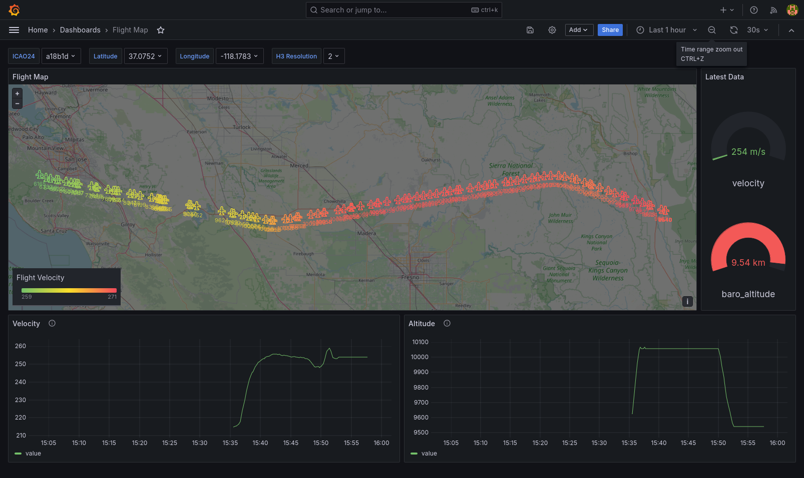
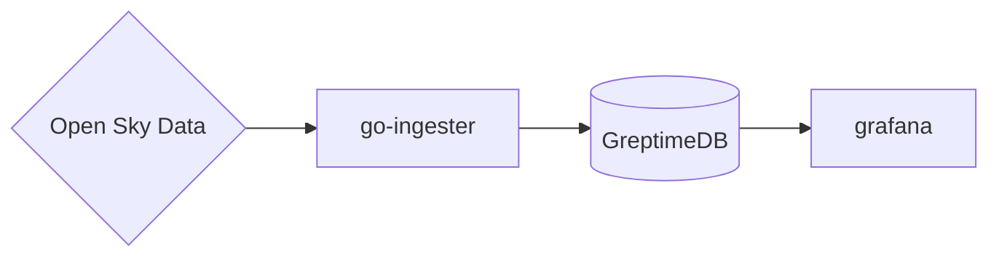

# GreptimeDB Flight

This project demonstrates GreptimeDB's ability to ingest geo-spatial data using the
`greptimedb-ingester-go` client. It fetches current aircraft positions within a
configured bounding box from the [OpenSky Network API](https://openskynetwork.github.io/opensky-api/rest.html)
every 60 seconds and writes them to GreptimeDB.



## How to run this demo

Ensure you have `git`, `docker`, `docker-compose`
installed. To run this demo:

```shell
git clone https://github.com/GreptimeTeam/demo-scene.git
cd demo-scene/flight-data-ingester
export OPENSKY_CLIENT_ID="<client-id>"
export OPENSKY_CLIENT_SECRET="<client-secret>"
docker compose up
```

It can take a while for the first run to pull down images and also build
necessary components.

Open your browser at `http://localhost:3000` and find our preconfigured grafana dashboard `Flight-map`. The default user/password is `admin/admin`.

## How it works

The topology is illustrated in this diagram.



after GreptimeDB starts, we use the `ingester` script which uses the go client's
[high level api](https://docs.greptime.com/user-guide/ingest-data/for-iot/grpc-sdks/go/#installation)
to create the table and insert data. It's dead-simple to perform transformations and data munging for insertion into target GretimeDB tables.
Create and tag your metric struct accordingly as seen in the `./ingester/dto.go` file.

## OpenSky configuration

Create an API client in the OpenSky account page and set `OPENSKY_CLIENT_ID`
and `OPENSKY_CLIENT_SECRET`. The ingester obtains and refreshes OAuth2 access
tokens. OpenSky no longer accepts username/password Basic Auth.

`OPENSKY_BBOX` contains `lamin,lomin,lamax,lomax` in degrees. The default,
`37,-123,38,-121`, covers the San Francisco Bay Area. For another area:

```shell
OPENSKY_BBOX="40,-75,41,-73" docker compose up
```

An empty area produces no rows. API failures, including quota errors, are logged.
The departure endpoint provides historical flights processed overnight; this
demo uses current state vectors instead of recent airport departures.

Stop the demo with `docker compose down`.

## Schema

`icao24_state` uses `icao24` as its only tag and `ts` as the time index.
Coordinates, altitude, velocity, and position time are fields.
An existing table created by an older version has different primary keys.
Run the updated demo against a fresh database; this demo does not migrate existing data.
