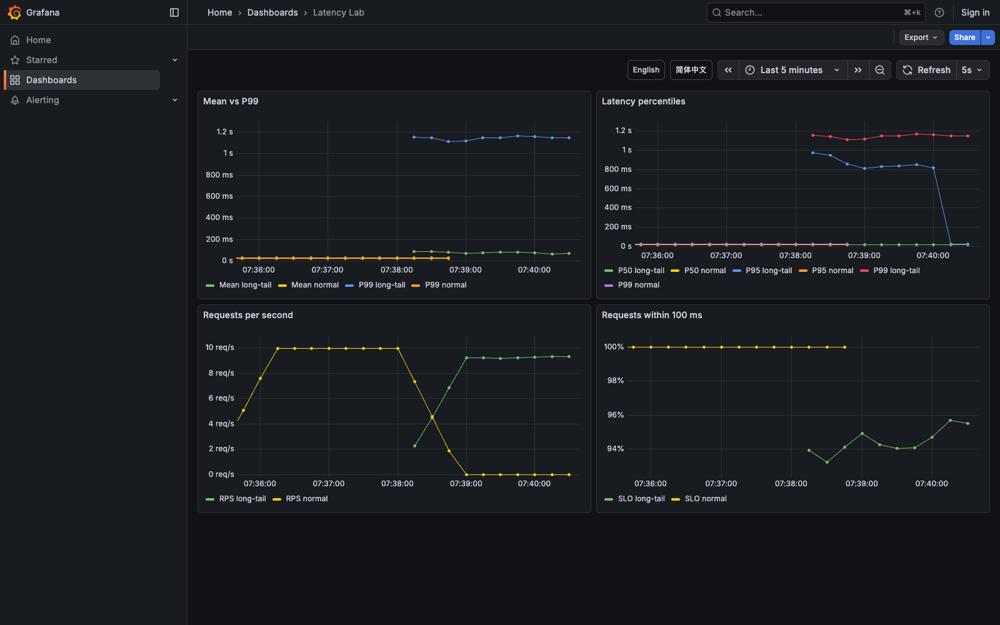

# Native Histogram Lab

An HTTP latency experiment using GreptimeDB v1.3, OTLP exponential histograms, and Grafana PromQL.



[Chinese dashboard](screenshots/dashboard-zh.png) · [Scenario controls](screenshots/controls.png)

## Run

Requires Docker Compose 2.24 or later. Run one demo at a time: the default ports are shared with other demos.

```sh
git clone https://github.com/GreptimeTeam/demo-scene.git
cd demo-scene/native-histogram-lab
docker compose up -d --build --wait
```

Open the [controls](http://localhost:8080) and [Grafana](http://localhost:3000). Grafana selects English or Chinese from the browser's preferred language. Dashboard links switch languages while preserving the selected time range.

Four workers issue real HTTP requests. The handler records elapsed processing time and exports cumulative exponential histograms every five seconds. Allow one minute for rate queries to populate.

| Scenario | Behavior |
| --- | --- |
| Normal | 15–25 ms processing delay, approximately 10 requests/s |
| Long tail | 5% of requests have an 800–1200 ms delay |
| Burst | Approximately 40 requests/s, with the normal processing delay |

The dashboard shows mean latency, P50/P95/P99, request rate, and the fraction of requests within 100 ms. Long-tail requests increase P99 much more than the mean. The load generator has four concurrent workers; slow requests reduce its achieved request rate.

## Queries

```promql
histogram_quantile(0.99, rate(lab_request_duration_seconds[1m]))
histogram_avg(rate(lab_request_duration_seconds[1m]))
histogram_count(rate(lab_request_duration_seconds[1m]))
histogram_fraction(0, 0.1, rate(lab_request_duration_seconds[1m]))
```

This demo uses the cumulative OTLP exponential histogram support enabled by default in v1.3. Each scenario has a separate series. Previously selected scenarios remain visible in the time range.

```sh
docker compose logs app
docker compose down
```
