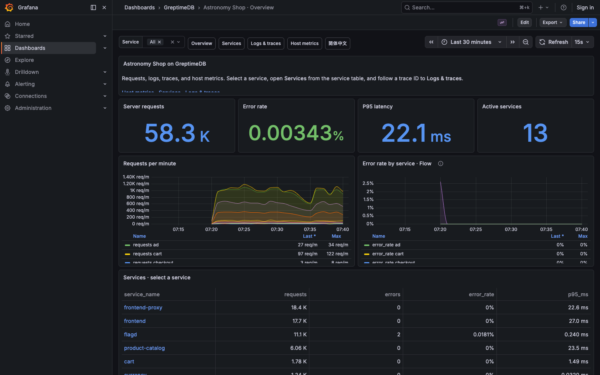

# GreptimeDB Observability Playground

English | [简体中文](README.zh-CN.md)

OpenTelemetry Astronomy Shop with metrics, logs, and traces stored in GreptimeDB. Grafana dashboards cover services, logs, traces, and host metrics, with English and Chinese versions.

The Overview dashboard includes a SQL query that joins request counts, application logs, and host memory by minute. Flow computes per-service request and error counts every 30 seconds.



## Run

Requires Docker with Compose, Git, and Python 3.11+. Start Docker, then run:

```bash
git clone https://github.com/GreptimeTeam/demo-scene.git
cd demo-scene/opentelemetry-playground
python3 demo.py up
```

The first run downloads pinned images. The load generator starts shopping traffic automatically; allow time for telemetry to arrive.

- [Shop](http://localhost:18080)
- [Grafana](http://localhost:13000) · [中文大盘](http://localhost:13000/d/astronomy-shop-greptimedb-zh)
- [GreptimeDB](http://localhost:24000/dashboard)

The Grafana root URL selects a dashboard from the browser's preferred language. Switch dashboard languages using **English / 简体中文** at the top. Time ranges and filters carry over.

## Try a payment failure

1. In [feature flags](http://localhost:18080/feature), set `paymentFailure` to `100%`. This affects all payment requests in the demo.
2. Check out in the shop, or wait for generated traffic. Checkout returns HTTP 422 with `PAYMENT_FAILED`.
3. In Grafana's Services dashboard, select `payment` and open a trace from **Recent requests · errors first**.
4. Inspect the `checkout` → `payment` spans. Filter logs by `WARN` and `Invalid token` to find the payment error.
5. Restore `paymentFailure` to `off`, including when stopping the demonstration early. Checkout should succeed again.

## Verify and stop

With the payment failure flag off:

```bash
python3 verify.py
python3 demo.py logs otel-collector init-flows
python3 demo.py down
```

Verification checks a checkout, telemetry ingestion, and all 80 data panels across both languages. It exits nonzero on failure; it does not test browser interactions. `down` removes this project's containers and retains the GreptimeDB data volume.

## Runtime details

- Grafana permits anonymous Admin access. Published ports bind to `127.0.0.1`; node_exporter uses host networking on port 9100 instead.
- On macOS, host metrics describe the Docker / OrbStack Linux VM. Container memory includes all projects on that Docker host.
- Request counts include only server spans. Latency percentiles are approximate; Flow counts for the current minute are incomplete. The SQL join associates signals by time, not causality.
- Trace details load all stored spans for a trace ID. Logs still follow the dashboard time range and filters.
- The launcher uses the `demo-scene-otel-playground` Compose project and stores generated files in `.runtime/`. Collector configuration is in [otelcol-config-greptime.yml](otelcol-config-greptime.yml); scrape targets are in [prometheus.yml](prometheus.yml).
