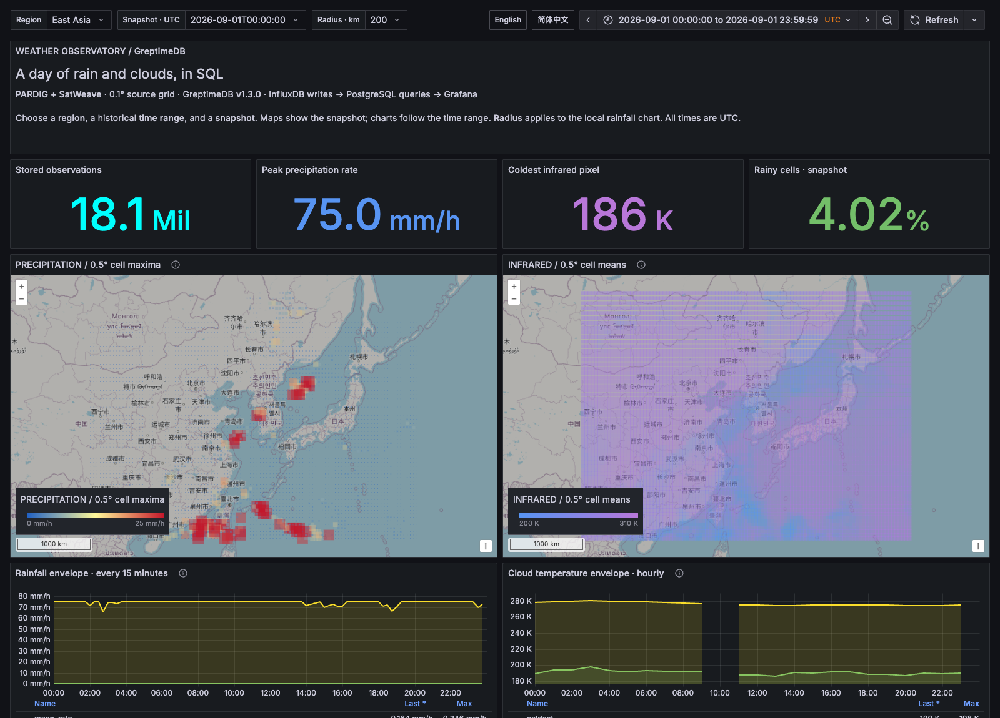
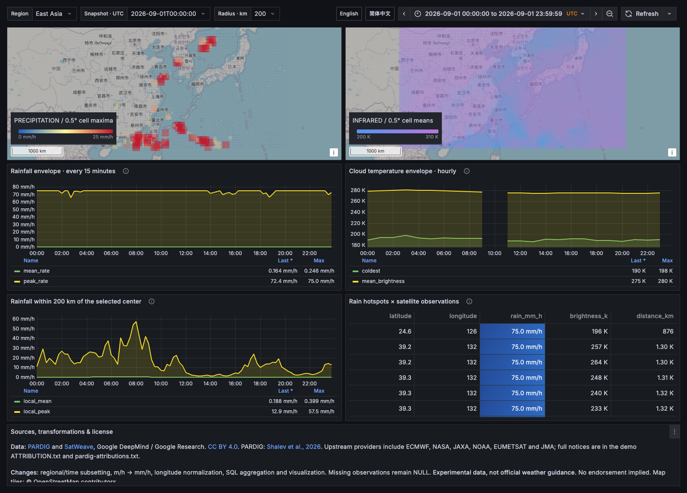

# Weather Observatory on GreptimeDB

[PARDIG precipitation estimates](https://developers.google.cn/weathernext/guides/pardig) and [SatWeave satellite observations](https://developers.google.cn/weathernext/guides/satweave), stored in **GreptimeDB v1.3.0** and queried from Grafana through its built-in PostgreSQL datasource. Data enters through the InfluxDB Line Protocol endpoint.

The default import contains **18,297,840 observations** from East Asia and the San Francisco Bay Area for September 1, 2026 (UTC). Source resolution is 0.1°; PARDIG samples every 15 minutes and SatWeave every hour. This demo imports SatWeave's 11.2 μm infrared band.

The dashboard includes precipitation and infrared maps, regional time series, distance filtering around a city, and a SQL join between precipitation and satellite observations. The entry page selects English or Chinese from the browser's preferred language. The dashboard links switch languages while retaining filters and time ranges.

## Screenshots

East Asia precipitation and infrared observations in the English dashboard.



Regional time series, rainfall within 200 km of Shanghai, and precipitation joined with satellite observations.



## Run

Requires Docker with Compose v2 and network access to Docker Hub, PyPI, Google Cloud Storage, and OpenStreetMap. The database, Grafana, and Python 3.11 importer run in containers. Public data access does not require a Google account or API key in this tested setup.

```sh
git clone https://github.com/GreptimeTeam/demo-scene.git
cd demo-scene/weather-data-ingester
docker compose up -d greptimedb grafana gateway
docker compose build ingest
docker compose run --rm ingest --plan
docker compose run --rm ingest
```

The importer prints one progress line after each verified frame and the dashboard URL when complete. First-run duration includes image downloads, global data-block reads, regional extraction, ingestion, and verification. `--plan` prints the expected row count without downloading or writing data.

Open **[Weather Observatory](http://localhost:23000/)**. Chinese browsers enter the Chinese dashboard; other languages enter English. Direct links: [English](http://localhost:23000/d/weather-observatory) · [简体中文](http://localhost:23000/d/weather-observatory-zh).

Ports bind to `127.0.0.1`:

| Service | Address |
| --- | --- |
| Grafana and language selector | `http://localhost:23000` |
| GreptimeDB HTTP / SQL / InfluxDB | `http://localhost:28400` |
| GreptimeDB PostgreSQL | `localhost:28403` |

Override `GRAFANA_PORT`, `GREPTIME_HTTP_PORT`, or `GREPTIME_PG_PORT` if needed. The importer prints the default Grafana port; adjust the printed URL when overriding it. Grafana permits anonymous Viewer access. This configuration is for local demonstrations.

## Select a city or region

List the built-in choices:

```sh
docker compose run --rm ingest --list-regions
```

Select one or more named regions:

```sh
docker compose run --rm ingest --region east-asia --region bay-area
```

Select cities by their listed English name or Chinese alias. Names with spaces must be quoted:

```sh
docker compose run --rm ingest \
  --city Shanghai --city 'San Francisco' --radius-km 200

# The same cities using Chinese aliases:
docker compose run --rm ingest --city 上海 --city 旧金山 --radius-km 200 --plan
```

The registry includes Shanghai, San Francisco, San Jose, Beijing, Shenzhen, Hangzhou, Hong Kong, Tokyo, Seattle, New York, London, and Singapore. Unknown names fail with an error; the importer does not silently resolve ambiguous names through an external geocoder.

City selection downloads a **bounding box enclosing the specified radius**, not a circular mask. The Grafana radius chart applies the exact spherical-distance predicate to imported grid points. Set a dashboard radius no larger than the imported city radius when complete circular coverage is required.

For another location, supply **west, south, east, north** in degrees:

```sh
# Greater Los Angeles
docker compose run --rm ingest --bbox -119 33 -117 35
```

Bounding boxes must not cross the antimeridian. The source's 0–360° longitude convention is normalized to −180–180° before selection, including boxes crossing the prime meridian. Custom bounding-box centers use the box midpoint; built-in regions use Shanghai and San Francisco. Loaded regions appear in the dashboard selector. Different city radii receive different region IDs.

## Change the time range or scale up

`--start` is inclusive and `--end` is exclusive. Both require a timezone and 15-minute alignment. This importer reads the per-frame archive from **2026 onward**; it does not read the older multi-year layout. PARDIG frames are selected every 15 minutes; SatWeave uses only hourly timestamps within the interval.

```sh
# A short first run: two PARDIG frames and one SatWeave frame.
docker compose run --rm ingest \
  --region bay-area \
  --start 2026-09-01T00:00:00Z --end 2026-09-01T00:30:00Z

# Three days for both default regions: about 54.9 million rows.
docker compose run --rm ingest \
  --start 2026-09-01T00:00:00Z --end 2026-09-04T00:00:00Z --plan
# Remove --plan to download and ingest this interval.
```

Use the printed dashboard URL to carry the imported time range and region into Grafana. A time range outside the imported interval has no data. Snapshots are hourly timestamps present in SatWeave; charts retain PARDIG's 15-minute resolution.

The older PARDIG-NRT, PARDIG-LR, and 17-band SatWeave archives contain approximately **9.1 TB, 22.7 TB, and 77.3 TB** of uncompressed numeric arrays, respectively, based on their actual Zarr metadata. These are logical sizes, not download sizes. The default demo is a regional subset, not a copy of those archives. Even a small regional extraction reads a global spatial chunk; multiple requested regions reuse that chunk in memory.

## Inspect ingestion and queries

Each frame is checked against its extracted source values: row count, non-null count, and numeric sum per region. The importer preserves missing values as SQL NULL. It stops on a missing source, decoding failure, failed write, or mismatch.

- `data/cache/`: compressed regional CSVs and source metadata, keyed by dataset, timestamp, and region configuration.
- `data/run-*.json`: source URLs, cache hits, read times, acknowledged write times, counts, and total elapsed time.
- `data/`: excluded from Git; the database uses a Docker named volume.

Re-run the same command after an interruption. Completed extracts are read from cache, and the same `(region_id, grid_id, ts)` keys are rewritten without adding duplicate observations. The reported write rate counts acknowledged row writes, including rewrites. It excludes decoding, CSV handling, request serialization, and validation; it is **not** a sustained end-to-end ingestion benchmark. The report also records full elapsed time. Do not compare this rate to another system without matching the workload and measurement boundary.

Run the query and Grafana checks:

```sh
docker compose run --rm --entrypoint python ingest verify.py --region east-asia
docker compose run --rm --entrypoint python ingest verify.py --region bay-area

docker compose run --rm -e GRAFANA_URL=http://grafana:3000 \
  --entrypoint python ingest verify_grafana.py --region east-asia
docker compose run --rm -e GRAFANA_URL=http://grafana:3000 \
  --entrypoint python ingest verify_grafana.py --region bay-area

docker compose run --rm --entrypoint python ingest -m unittest test_ingest -v
```

`verify.py` measures three HTTP SQL executions per query, retaining each timing and the result. `verify_grafana.py` executes all data panels in both languages through Grafana's PostgreSQL datasource and rejects errors or empty results. These checks do not replace browser rendering tests. See [VALIDATION.md](VALIDATION.md) for the measured run and [PERFORMANCE.md](PERFORMANCE.md) for schema/index comparisons and adoption status.

Example spatial query through HTTP SQL:

```sh
curl -sS 'http://localhost:28400/v1/sql?db=weather' --data-urlencode "sql=
SELECT ts, AVG(rain_mm_h) AS mean_rate
FROM pardig
WHERE region_id = 'bay-area'
  AND st_distance_sphere_m(
    wkt_point_from_latlng(latitude, longitude),
    wkt_point_from_latlng(37.7749, -122.4194)) <= 50000
GROUP BY ts ORDER BY ts"
```

Both data tables use `region_id` and `grid_id` as primary-key columns and `ts` as the time index. Coordinates are DOUBLE columns; spatial queries construct WKT points and filter directly with `st_distance_sphere_m`. Encoded grid-coordinate range filters are confined to the experiments in [PERFORMANCE.md](PERFORMANCE.md). The demo does not claim a native GEOPOINT column type or a dedicated spatial index.

## Dashboard behavior

- **Maps:** one selected snapshot, aggregated for display into 0.5° cells. Rain uses the cell maximum; infrared uses the cell mean. Original 0.1° rows remain in the database. Marker size represents rainfall intensity. The color scale saturates at 25 mm/h; tooltips retain the actual value.
- **Time series:** instantaneous precipitation rate in mm/h and infrared brightness temperature in kelvin. Rainfall is not accumulated depth; brightness temperature is not surface air temperature. Regional means are unweighted grid means, not area-weighted means.
- **Hotspot table:** an exact join on region, grid ID, and UTC timestamp. No interpolation or forward fill. The join demonstrates association, not a causal relationship.
- **Missing data:** values remain NULL. Sensor coverage gaps are not converted to zero. High-latitude and sensor artifacts remain properties of the source datasets.
- **Language:** browser language selects a dashboard only at `/`. Direct dashboard URLs and the language links select a specific language. Grafana's own navigation chrome follows Grafana's locale settings; dashboard content is translated.

Dashboard JSON is generated by `build_dashboard.py`. After editing it, run `python3 build_dashboard.py`; Grafana reloads provisioned dashboards automatically. No third-party Grafana datasource or panel plugin is required.

## Stop

```sh
docker compose down
```

This stops this demo's services and retains the database volume and download cache. Start the services again to query the existing data. The Compose project is `greptime-weather`; it does not reuse the flight demo's data or ports.

## Attribution

PARDIG and SatWeave are published by Google DeepMind and Google Research under [CC BY 4.0](https://creativecommons.org/licenses/by/4.0/). Commercial use, modification, and redistribution require attribution and disclosure of changes. Keep [ATTRIBUTION.txt](ATTRIBUTION.txt) and [pardig-attributions.txt](pardig-attributions.txt) with redistributed extracts and visualizations. These experimental datasets are not official weather forecasts or warnings. Google and the upstream providers do not endorse this demonstration.
